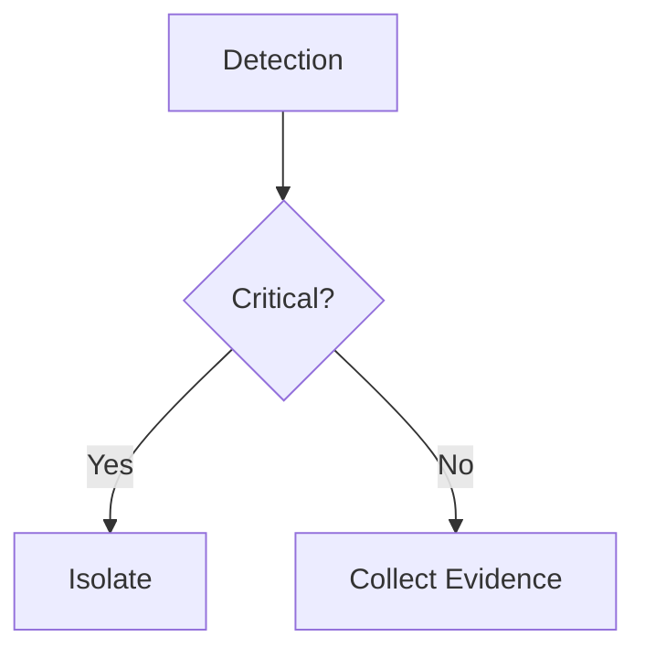

# Configuration

## Frontend Configuration

### Environment Variables

Create a `.env` file in the `web/` directory:

```bash
VITE_APP_PORT=5177
VITE_API_URL=http://localhost:8000
VITE_STORAGE_KEY=playbook-forge-v1
VITE_ENABLE_BACKEND=false
VITE_THEME_DEFAULT=soc
```

| Variable | Description | Default |
|----------|-------------|---------|
| `VITE_APP_PORT` | Frontend port | 5177 |
| `VITE_API_URL` | Backend API URL (read by `web/src/api/client.ts`) | http://localhost:8000 |
| `VITE_HOTWASH_API_KEY` | Local development convenience only. Read by `npm run dev` and ignored by production builds, so it is never bundled. In a deployed UI, enter the key in the settings panel (gear, bottom left); it is kept for the browser session. | (unset) |
| `VITE_STORAGE_KEY` | localStorage key for playbooks | playbook-forge-v1 |
| `VITE_ENABLE_BACKEND` | Enable backend features (storage, sync) | false |
| `VITE_THEME_DEFAULT` | Default theme on first load | soc |

### Running Frontend Only

```bash
cd web
npm install
npm run dev
```

Starts on `http://localhost:5177`

The app works completely offline without backend. Users can parse Markdown, create flowcharts, and export locally.

### Running with Backend

If you want to enable playbook storage and sharing:

```bash
# Frontend
cd web
VITE_ENABLE_BACKEND=true \
VITE_API_URL=http://localhost:8000 \
VITE_HOTWASH_API_KEY=choose-a-strong-key \
npm run dev   # dev only; a built UI takes the key from the settings panel

# Backend (in another terminal, from the repo root)
python3 -m venv .venv && .venv/bin/pip install -r requirements.txt
HOTWASH_API_KEY=choose-a-strong-key .venv/bin/uvicorn api.main:app --port 8000
```

Backend runs on `http://localhost:8000`

## Backend Configuration

### Environment Variables

The backend reads configuration from the process environment (there is no
`.env` loader). Export the variables before starting uvicorn, or pass
`--env-file` to uvicorn:

```bash
HOTWASH_API_KEY=choose-a-strong-key
HOTWASH_CORS_ORIGINS=http://localhost:5177
```

| Variable | Description | Default |
|----------|-------------|---------|
| `HOTWASH_API_KEY` | **Required for any real deployment.** Shared API key checked on every authenticated route (`X-API-Key` header). When unset, the server generates a random ephemeral key that is never logged, so authenticated routes are effectively unreachable until you set this. | (ephemeral, unusable) |
| `HOTWASH_CORS_ORIGINS` | Allowed frontend origins, comma-separated. Set this when serving the frontend from anything other than localhost. | http://localhost:5177,http://localhost:3000 |
| `HOTWASH_ENCRYPTION_KEY` | Fernet key for integration secrets at rest. Overrides the key file. | (empty) |
| `HOTWASH_KEY_PATH` | Path to the Fernet key file, auto-created with mode 0600. | `~/.encryption_key` |
| `HOTWASH_WAZUH_SEED_SECRET` | HMAC secret for the seeded Wazuh ingest mapping. | (random per seed) |
| `HOTWASH_PLAYBOOK_SEED_DIR` | Directory of markdown playbooks inserted on first run when the database is empty. Paths may be absolute or relative; `~` is expanded. | `api/seed_data/playbooks` (shipped with the app) |
| `HOTWASH_PRIVATE_HOST_ALLOWLIST` | CIDRs exempt from the outbound SSRF block (see below). | (empty) |
| `HOTWASH_WAZUH_AR_COMMANDS` | Comma-separated allow-list of Wazuh active-response commands. Active response is disabled until this names at least one command; only listed commands can be dispatched. | (empty, disabled) |
| `HOTWASH_READ_ONLY_API_KEY` | Optional second key with read scope. It can call safe methods (`GET`, `HEAD`, `OPTIONS`) and open live sockets, and every other request is refused with `403`. Must differ from `HOTWASH_API_KEY`. | (unset) |
| `HOTWASH_READ_ONLY` | When `true`, every key is limited to read scope, including `HOTWASH_API_KEY`. The signed Wazuh ingest webhook is unaffected. | `false` |
| `HOTWASH_MAX_UPSTREAM_BYTES` | Largest response body accepted from TheHive, Wazuh, or a webhook target. Larger bodies are cut off and reported as an upstream error. | 5242880 |

### Database Setup

SQLite only. The database is auto-created on first run at
`api/data/playbooks.db` (gitignored).

On startup, when the playbook table is empty, the API reads markdown files from
`HOTWASH_PLAYBOOK_SEED_DIR` (default: `api/seed_data/playbooks` in this repo) and
inserts them. That directory ships with sample playbooks, including the Wazuh
vulnerability-export runbook used by the default ingest mapping. If the seed
directory is missing or contains no markdown files, startup logs an informational
message and continues with an empty library. Override `HOTWASH_PLAYBOOK_SEED_DIR`
to seed from your own playbook collection (for example, a shared workspace
directory of `.md` runbooks).

## Backend Integration Variables

### `HOTWASH_PRIVATE_HOST_ALLOWLIST`

Comma-separated list of CIDRs that override the SSRF block on outbound integration URLs. Default: empty (all RFC1918, loopback, and link-local blocked).

<!-- content-guard: allow private-ipv4 -->
Use for lab/dev only. In this fabricated private-network example, `HOTWASH_PRIVATE_HOST_ALLOWLIST=172.27.83.0/24,10.0.0.0/8` lets the API talk to a TheHive VM at `172.27.83.42`. Loopback (`127.0.0.0/8`) and link-local (`169.254.0.0/16`) are never allowed, even if listed.

### `HOTWASH_LIVE_THEHIVE_URL` / `HOTWASH_LIVE_THEHIVE_API_KEY`

Optional. Required only to run the opt-in TheHive live smoke test:

```bash
pytest api/tests/test_thehive_live.py -m live -v -s
```

See `docs/THEHIVE-INTEGRATION.md` for details.

### Wazuh Manager Connector

The Wazuh integration row stores:

| Field | Description |
|-------|-------------|
| `base_url` | Wazuh manager API URL, for example `https://wazuh.example:55000`. |
| `username` | Wazuh API username used for Basic auth during JWT authentication. |
| `password` | Wazuh API password, encrypted at rest. |
| `verify_ssl` | Whether to verify the Wazuh manager TLS certificate. |

The connector exposes these generic action endpoints:

```bash
GET  /api/integrations/wazuh/actions
POST /api/integrations/wazuh/actions/get_agents
POST /api/integrations/wazuh/actions/get_agent
POST /api/integrations/wazuh/actions/run_active_response
```

`get_agents` accepts optional `status`, `search`, `limit`, and `select`.
`get_agent` requires a digit-only `agent_id`. `run_active_response` requires
`command` and a non-empty digit-only `agent_ids` list, with optional
`arguments` and `alert`.

`run_active_response` triggers response actions on endpoints, so it is closed by
default. Name the permitted commands in `HOTWASH_WAZUH_AR_COMMANDS`
(comma-separated). While the variable is unset or empty the action returns
`403`, and a command outside the list returns `422`. Every request must also
carry `"confirm": true`. Add `"dry_run": true` to validate the request and see
what would be sent without contacting Wazuh (Wazuh itself has no dry-run mode,
so Hotwash stops before the upstream call). A partial failure (some agents in `failed_items`) is surfaced in the
action result as `failed`/`total_failed` rather than reported as success.

### `HOTWASH_LIVE_WAZUH_URL` / `HOTWASH_LIVE_WAZUH_USERNAME` / `HOTWASH_LIVE_WAZUH_PASSWORD`

Optional. Required only to run the opt-in Wazuh live smoke test:

```bash
pytest api/tests/test_wazuh_live.py -m live -v -s
```

## Theme Variants

Access Hotwash variants directly:

- `http://localhost:5177/` - SOC theme (default)
- `http://localhost:5177/?theme=analyst` - Analyst theme
- `http://localhost:5177/?theme=terminal` - Terminal theme
- `http://localhost:5177/?theme=command` - Command theme
- `http://localhost:5177/?theme=cyber` - Cyber Noir theme

Theme preference is saved to localStorage and restored on next visit.

## Playbook Import Formats

### Markdown Format

Place Markdown playbooks in the library. Expected structure:

```markdown
# Incident Response: Ransomware

## Phase: Detection
- Step: Identify affected systems
  - Review EDR alerts
  - Check SIEM correlation
  
- Decision: Is it a critical system?
  - YES -> Execute: Isolate network
  - NO -> Execute: Preserve evidence

## Phase: Analysis
- Step: Begin forensic collection
```

### Mermaid Format

Paste Mermaid flowchart syntax:



Both formats are automatically converted to the same internal node-edge graph.

## Playbook Storage

### Frontend-Only Storage

Playbooks are stored in localStorage with key `playbook-forge-v1`:

```json
{
  "recentPlaybooks": [
    {
      "id": "uuid",
      "title": "Ransomware IR",
      "markdown": "# Incident Response...",
      "nodes": [...],
      "edges": [...],
      "modified_at": "2026-02-09T10:00:00Z"
    }
  ]
}
```

Max size: ~5MB (depends on browser). Good for 50-100 playbooks.

### Backend Storage

With backend enabled, playbooks are stored in database:

```sql
CREATE TABLE playbooks (
  id TEXT PRIMARY KEY,
  title TEXT NOT NULL,
  description TEXT,
  markdown TEXT,
  category TEXT,
  tags TEXT,
  created_by TEXT,
  created_at TIMESTAMP,
  updated_at TIMESTAMP
);
```

Enables:
- Team sharing and collaboration
- Persistent storage across devices
- Version history
- Search and filtering

## SOAR Action Library

Configure available SOAR actions by editing `web/src/data/soarActions.ts`:

```typescript
export const SOAR_ACTIONS = [
  {
    id: 'isolate_host',
    name: 'Isolate Host',
    platform: 'generic',
    parameters: {
      hostname: { type: 'string', required: true },
    },
  },
  // Add more actions
];
```

Actions available in the Execute node type dropdown.

## Playbook Categories

Built-in categories for organizing playbooks:

- **incident-response** - Respond to security incidents
- **threat-hunting** - Proactive threat detection
- **vulnerability-management** - Patch and remediate
- **forensics** - Digital investigation
- **compliance** - Audit and regulatory
- **custom** - User-defined

Configure categories in `web/src/data/categories.ts`.

## Markdown Parsing Rules

The parser follows these rules when converting Markdown to nodes:

| Markdown | Node Type | Notes |
|----------|-----------|-------|
| `## Phase: Name` | Phase | Major response phase |
| `- Step: Name` | Step | Procedural step within phase |
| `- Decision: Name` | Decision | Yes/No conditional branch |
| `- Execute: Name` | Execute | SOAR action or tool |
| Indented bullet (3+ spaces) | Sub-item | Attached to parent as notes |

Example:

```markdown
## Phase: Containment
- Step: Isolate host
  - Remove from network
  - Disable user account
  - Capture RAM dump

- Decision: Is malware spreading?
  - YES -> Execute: Segment network
  - NO -> Execute: Continue analysis
```

Parses to:

```
Phase[Containment]
  └─ Step[Isolate host] (notes: Remove from network...)
      └─ Decision[Is malware spreading?]
          ├─ Edge(Yes) -> Execute[Segment network]
          └─ Edge(No) -> Execute[Continue analysis]
```

## Export Formats

### JSON Export

Full graph representation (nodes, edges, metadata):

```json
{
  "title": "Ransomware IR",
  "nodes": [
    {
      "id": "phase-1",
      "type": "phase",
      "data": { "label": "Detection" }
    }
  ],
  "edges": [...]
}
```

Use for backup and sharing with system that can import JSON.

### Mermaid Export

Mermaid flowchart syntax (human-readable):


Use for sharing with teams, embedding in documentation, or rendering in external tools.

### Markdown Export

Playbook as structured Markdown:

```markdown
# Ransomware Incident Response

## Phase: Detection
- Step: Identify affected systems
  - Check EDR alerts
  - Correlate SIEM events
```

Use for documentation, archival, and sharing.

## Guided Tour

First-time users see an interactive tour powered by driver.js. Configure in `web/src/components/GuidedTour.tsx`:

```typescript
const tourSteps = [
  {
    element: '.canvas-container',
    popover: {
      title: 'Interactive Canvas',
      description: 'Drag nodes, connect with edges, and build your flowchart',
    },
  },
];
```

Disable tour:

```typescript
localStorage.setItem('playbook-forge-tour-completed', 'true');
```

Or via environment:

```bash
VITE_ENABLE_TOUR=false npm run dev
```

## Performance Optimization

### For Large Playbooks

If you have 200+ nodes:

1. **Split into sub-playbooks** - Divide by phase or incident type
2. **Archive old playbooks** - Export to Markdown and delete locally
3. **Use Mermaid export** - Share as text rather than interactive graph

### Storage Quota

Monitor localStorage usage:

```javascript
navigator.storage.estimate().then(estimate => {
  console.log(`Usage: ${estimate.usage / 1024 / 1024} MB`);
  console.log(`Quota: ${estimate.quota / 1024 / 1024} MB`);
});
```

If nearing quota:
1. Export old playbooks to JSON
2. Delete from localStorage
3. Re-import as needed

### Canvas Rendering

React Flow uses virtualization for large graphs. If experiencing lag:

1. Reduce number of nodes (<200 recommended)
2. Disable minimap for playbooks >100 nodes
3. Use View-Only mode instead of Edit mode

## Keyboard Shortcuts

| Key | Action |
|-----|--------|
| `D` | Add Decision node |
| `S` | Add Step node |
| `E` | Add Execute node |
| `Delete` | Delete selected node |
| `Ctrl+Z` / `Cmd+Z` | Undo (localStorage-based) |
| `Ctrl+S` / `Cmd+S` | Export playbook |

## Troubleshooting

### Playbook Not Loading from Backend

Check CORS configuration. The backend allows the origins in
`HOTWASH_CORS_ORIGINS` (comma-separated, defaults to the localhost dev
ports). If the frontend is served from another origin, set:

```bash
HOTWASH_CORS_ORIGINS=https://hotwash.example.com .venv/bin/uvicorn api.main:app --port 8000
```

Also confirm the frontend has `VITE_ENABLE_BACKEND=true` and `VITE_API_URL`
pointing at the backend, and that the backend's `HOTWASH_API_KEY` has been
entered in the UI settings panel for this browser session.

### Canvas Freezing on Large Playbooks

Reduce node count or switch to View-Only mode. For persistent issues, split into multiple playbooks.
